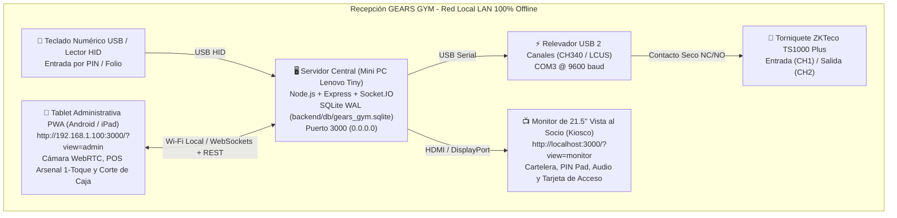

# 💀 GEARS GYM - Sistema Conectado de Control de Acceso & Administración (Release v1.0)

[](#stack-tecnológico)
[](#resumen-ejecutivo)
[](#capa-de-abstracción-de-hardware-hal)
[](#4-blindaje-100-offline-cero-cdns-ergonomía-kiosco-y-auto-arranque-windows)

Sistema integral de control de acceso físico, monitoreo biométrico/PIN en tiempo real, gestión transaccional de socios con cámara en vivo y punto de venta administrativo (**POS Arsenal + Corte de Caja**) para **GEARS GYM**. Diseñado bajo una estricta arquitectura **100% Offline-First (Cero CDNs externos)**, el sistema opera de forma autónoma en red local (LAN) garantizando continuidad total sin conexión a Internet.

---

## 📑 Tabla de Contenidos
1. [Resumen Ejecutivo & Topología](#resumen-ejecutivo)
2. [Módulos Operativos de Recepción y Cierre de Producción v1.0](#módulos-operativos-de-recepción-y-cierre-de-producción-v10)
   - [1. Módulo Operativo de Socios (CRUD + Cámara WebRTC)](#1-módulo-operativo-de-socios-crud--cámara-webrtc)
   - [2. Punto de Venta Rápido "Arsenal" (1-Toque) y Corte de Caja en SQLite](#2-punto-de-venta-rápido-arsenal-1-toque-y-corte-de-caja-en-sqlite)
   - [3. Acceso Híbrido por PIN / Teclado Numérico HID + Biométrico](#3-acceso-híbrido-por-pin--teclado-numérico-hid--biométrico)
   - [4. Blindaje 100% Offline (Cero CDNs), Ergonomía Kiosco y Auto-Arranque Windows](#4-blindaje-100-offline-cero-cdns-ergonomía-kiosco-y-auto-arranque-windows)
3. [Stack Tecnológico](#stack-tecnológico)
4. [Capa de Abstracción de Hardware (HAL)](#capa-de-abstracción-de-hardware-hal)
5. [Guía de Instalación y Despliegue](#guía-de-instalación-y-despliegue)
6. [Referencia de API REST](#referencia-de-api-rest)
7. [Referencia de Eventos WebSocket (Socket.IO)](#referencia-de-eventos-websocket-socketio)
8. [Documentación Complementaria](#documentación-complementaria)

---

## 🏢 Resumen Ejecutivo

GEARS GYM requiere una solución de alta disponibilidad para la recepción y control de acceso al gimnasio. La arquitectura elimina cualquier dependencia de servidores en la nube o CDNs externos para las operaciones críticas del día a día (registro de socios con fotografía, cobro de visitas y suplementos, corte de caja, apertura de torniquete y cartelera digital).



---

## 🚀 Módulos Operativos de Recepción y Cierre de Producción v1.0

### 1. Módulo Operativo de Socios (CRUD + Cámara WebRTC)
*   **CRUD Transaccional en SQLite (`backend/db/database.js`):**
    *   Alta de socios (`POST /api/members` / socket `CREATE_MEMBER`) con impacto contable inmediato en `today_cash` y `memberships_cash` de `daily_metrics`.
    *   Renovación de membresías (`PUT /api/members/:id/renew` / socket `RENEW_MEMBER`) sumando días vigentes (`days = CASE WHEN days > 0 THEN days + @extraDays ELSE @extraDays END`) y registrando el cobro en caja.
    *   Edición y baja de socios (`PUT /api/members/:id`, `DELETE /api/members/:id`) con sincronización en vivo (`MEMBERS_UPDATED`).
*   **Captura Fotográfica en Tablet (`NewMemberModal.jsx` y `EditMemberModal.jsx`):**
    *   Stream de video en vivo vía WebRTC (`navigator.mediaDevices.getUserMedia({ video: { facingMode: 'environment' } })`) con botón alternativo `<input type="file" accept="image/*" capture="environment">`.
    *   Recorte centrado (*center crop*) y compresión automática en `<canvas>` oculto a **`300x300 px` en formato JPEG (calidad `0.75`)**, produciendo cadenas Base64 ligeras (~15–25 KB) almacenadas directamente en SQLite.
*   **Autogeneración y Resolución Flexible de Folios:**
    *   Si no se especifica PIN/Folio en el alta, `generateNextFolio()` asigna automáticamente el siguiente folio consecutivo de 3 dígitos (`'089'`, `'090'`, etc.).
    *   La función `getMemberById(id)` resuelve folios tanto con ceros a la izquierda como sin ellos (`'042'` o `'42'`, `'089'` o `'89'`).
*   **Simulación de Huella en Vivo (`SociosTab.jsx`):**
    *   Cada fila de socio cuenta con el botón **"Pasar Huella"**, que dispara el relevador si el socio está vigente y proyecta su fotografía real, nombre, plan y días restantes en el Monitor de 21.5".

### 2. Punto de Venta Rápido "Arsenal" (1-Toque) y Corte de Caja en SQLite
*   **Persistencia Financiera (`store_sales` y `daily_metrics`):**
    *   Tabla `store_sales` (`id`, `item_id`, `item_name`, `price`, `timestamp`) vinculada transaccionalmente con `daily_metrics` (`today_cash`, `memberships_cash`, `visits_cash`, `store_cash`, `today_entries`).
*   **Botonera Touch de Venta en 1 Toque (`ArsenalTab.jsx` y `DashboardTab.jsx`):**
    *   Tarjetas táctiles de cobro inmediato para los 4 suplementos oficiales del Monitor:
        *   **Agua 1L** (`$20 MXN`)
        *   **Pre-Entreno Hype** (`$35 MXN`)
        *   **Proteína Whey** (`$30 MXN`)
        *   **Electrolitos** (`$15 MXN`)
    *   Al tocar cualquier producto, se ejecuta `POST /api/store/sale` (con respaldo WebSocket `RECORD_STORE_SALE`), descontando stock, reproduciendo confirmación sonora y actualizando la caja en todas las pantallas (`METRICS_SYNC`, `STORE_SALE_RECORDED`).
*   **Modal de Corte de Caja Diario (`GET /api/cash-cut` y `CashCutModal.jsx`):**
    *   Desglose auditado en tiempo real: **Total en Caja Hoy (`today_cash`)**, **Mensualidades/Renovaciones (`memberships_cash`)**, **Visitas del Día $60 (`visits_cash`)**, **Suplementos/Arsenal (`store_cash`)** y **Entradas Totales (`today_entries`)**, junto con las últimas 20 ventas de tienda y bitácora de accesos.

### 3. Acceso Híbrido por PIN / Teclado Numérico HID + Biométrico
*   **Teclado Físico USB / Lector HID en Monitor (`Monitor.jsx` y `TvSidebarInfo.jsx`):**
    *   Listener global `keydown` que captura dígitos numéricos (`0-9`), muestra un indicador enmascarado en vivo (`PIN: ***`) en la tarjeta del sensor y, al presionar `Enter`, emite `SENSOR_SCAN` con `{ memberId: inputBuffer, channel: 1 }`.
*   **Teclado Numérico Táctil en Pantalla (`PIN O HUELLA`):**
    *   Modal numérico limpio en `Monitor.jsx` para digitar el folio en pantallas táctiles o con mouse.
*   **Validación Rápida en Recepción (`TorniqueteTab.jsx`):**
    *   Campo directo en la Tablet para validar cualquier PIN/Folio y liberar el torniquete en un clic.

### 4. Blindaje 100% Offline (Cero CDNs), Ergonomía Kiosco y Auto-Arranque Windows
*   **Compilación 100% Local de Estilos e Iconografía:**
    *   Integración de `tailwindcss`, `@tailwindcss/vite` y `@fortawesome/fontawesome-free` en `src/index.css` y `src/main.jsx`.
    *   `dist/assets/` empaqueta todo el CSS, JS y fuentes `.woff2` localmente sin depender de `cdn.tailwindcss.com` ni `cdnjs.cloudflare.com`.
*   **Screen Wake Lock API (`src/utils/wakeLock.js`) y Ergonomía Kiosco:**
    *   Hook `useWakeLock()` activo en `Monitor.jsx` y `AdminPanel.jsx` que solicita `navigator.wakeLock.request('screen')` al montar y lo renueva en cada evento `visibilitychange`.
    *   Reglas CSS en `src/index.css` (`overscroll-behavior: none`, `user-select: none`, `touch-action: manipulation`) que bloquean gestos accidentales de zoom o recarga en la tablet.
*   **Service Worker `gears-gym-offline-v4` (`public/sw.js`):**
    *   Estrategia *Network-First* con respaldo en caché local para activos estáticos.
*   **Auto-Arranque en Windows 11 (`scripts/`):**
    *   `scripts/start-gears-kiosk.bat`: inicia `node backend/server.js` con bucle de reinicio automático en segundo plano, espera 3 segundos y lanza Chrome/Edge en Modo Kiosco (`--kiosk --autoplay-policy=no-user-gesture-required --disable-pinch --overscroll-history-navigation=0`) apuntando a `http://localhost:3000/?view=monitor`.
    *   `scripts/INSTALACION_MINIPC.md`: guía de 1 página para fijar IP estática, configurar puerto `COM3` (CH340), registrar el acceso directo en `shell:startup` y habilitar `chrome://flags/#unsafely-treat-insecure-origin-as-secure` en Android.

---

## 🛠️ Stack Tecnológico

| Capa | Tecnología | Rol en el Sistema |
| :--- | :--- | :--- |
| **Frontend** | **React 19 + Vite 6** | SPA optimizada compilada en `dist/`. Cero dependencias externas en tiempo de ejecución. |
| **Estilos & Iconos** | **Tailwind CSS v4 (`@tailwindcss/vite`) + FontAwesome 6 Local** | Empaquetado local de estilos, animaciones y webfonts `.woff2` sin CDNs. |
| **Backend** | **Node.js + Express 5** | Servidor monolítico (`limit: '5mb'`) que expone API REST y sirve estáticos en `0.0.0.0:3000`. |
| **Tiempo Real** | **Socket.IO 4.8** | Sincronización bidireccional instantánea (`maxHttpBufferSize: 5e6`) entre Tablet y Monitor. |
| **Base de Datos** | **better-sqlite3 11.10** | Motor relacional transaccional local configurado en modo **WAL (Write-Ahead Logging)**. |
| **Control de Hardware** | **serialport 13.0** | Disparo hexadecimal a relevador USB de 2 canales (`COM3` @ 9600 baud). |
| **Caché Offline & Kiosco** | **Service Worker `v4` + Screen Wake Lock API** | Operación continua sin suspensión de pantalla ni dependencia de red WAN. |

---

## ⚡ Capa de Abstracción de Hardware (HAL)

Ubicada en `backend/hardware/relay.js`, la clase `TurnstileRelayController` abstrae la comunicación física con el relevador USB de 2 canales conectado al torniquete ZKTeco TS1000 Plus:

*   **Canal 1 (Entrada):** Abrir `A0 01 01 A2` / Cerrar `A0 01 00 A1` (pulso de 800 ms con mutex anti-rebote).
*   **Canal 2 (Salida):** Abrir `A0 02 01 A3` / Cerrar `A0 02 00 A2` (pulso de 800 ms con mutex anti-rebote).
*   **Fallback Automático:** Si `COM3` no está conectado, opera en **Modo SIMULADOR** sin interrumpir el flujo del sistema.

---

## 🚀 Guía de Instalación y Despliegue

1. **Instalar Dependencias:**
   ```bash
   npm install
   ```
2. **Compilar el Frontend 100% Offline:**
   ```bash
   npm run build
   ```
3. **Iniciar el Servidor en Producción:**
   ```bash
   npm start
   ```
   *(O en Windows 11 mediante `scripts\start-gears-kiosk.bat` para arranque automático en Modo Kiosco).*
4. **Interfaces en Red Local:**
   *   **Monitor de Recepción (TV 21.5"):** `http://localhost:3000/?view=monitor`
   *   **Tablet Administrativa (PWA):** `http://192.168.1.100:3000/?view=admin`

---

## 📡 Referencia de API REST

| Método | Endpoint | Descripción | Parámetros / Body |
| :--- | :--- | :--- | :--- |
| `GET` | `/api/members` | Lista todos los socios registrados en SQLite. | Ninguno |
| `POST` | `/api/members` | Crea un socio (autogenera folio si se omite `id`), guarda foto Base64 y suma a caja. | `{ id?, name, phone, photo, plan, price, days }` |
| `PUT` | `/api/members/:id/renew` | Renueva membresía, suma días y registra ingreso en `daily_metrics`. | `{ plan, price, extraDays }` |
| `PUT` | `/api/members/:id` | Actualiza datos, foto, teléfono o presencia (`isInside`) de un socio. | `{ name?, phone?, photo?, plan?, price?, days?, isInside? }` |
| `DELETE` | `/api/members/:id` | Elimina un socio de la base de datos SQLite. | Ninguno |
| `POST` | `/api/store/sale` | Registra venta de suplemento en `store_sales` y suma a `store_cash` y `today_cash`. | `{ itemId, itemName, price }` |
| `GET` | `/api/cash-cut` | Devuelve el resumen completo de corte de caja del día, últimas 20 ventas y accesos. | `?date=YYYY-MM-DD` *(opcional)* |
| `GET` | `/api/metrics` | Consulta las métricas financieras y aforo del día actual. | Ninguno |
| `GET` | `/api/logs` | Retorna los últimos 50 accesos registrados en el torniquete. | Ninguno |
| `POST` | `/api/turnstile/override` | Dispara el relevador USB manualmente por canal. | `{ "channel": 1 \| 2 }` |

---

## 🔄 Referencia de Eventos WebSocket (Socket.IO)

| Evento | Emisor | Payload | Efecto en el Sistema |
| :--- | :--- | :--- | :--- |
| `CREATE_MEMBER` | Admin | `{ id?, name, phone, photo, plan, price, days }` | Crea socio en SQLite y emite `MEMBERS_UPDATED` y `METRICS_SYNC`. |
| `RENEW_MEMBER` | Admin | `{ id, plan, price, extraDays }` | Renueva socio en SQLite, suma a caja y emite `MEMBER_RENEWED`. |
| `UPDATE_MEMBER` | Admin | `{ id, ...data }` | Actualiza socio en SQLite y emite `MEMBERS_UPDATED`. |
| `DELETE_MEMBER` | Admin | `{ id }` | Elimina socio en SQLite y emite `MEMBERS_UPDATED`. |
| `RECORD_STORE_SALE` | Admin | `{ itemId, itemName, price }` | Registra venta del Arsenal y emite `STORE_SALE_RECORDED` y `METRICS_SYNC`. |
| `SENSOR_SCAN` | Admin / TV | `{ memberId, channel }` o `'active'\|'warning'\|'expired'` | Busca socio en SQLite (con o sin ceros a la izquierda), dispara relevador si está vigente y emite datos reales en `SHOW_ACCESS_CARD`. |
| `QUICK_VISIT` | Admin | `{ price: 60 }` | Registra visita del día ($60), abre Canal 1 y sincroniza métricas. |
| `MANUAL_OVERRIDE` | Admin | `{ channel: 1 \| 2 }` | Dispara relevador en el canal indicado e incrementa aforo. |
| `TOGGLE_LOCKDOWN` | Admin | `boolean` | Activa/desactiva el bloqueo total de emergencia del torniquete. |
| `MEMBERS_UPDATED` | Server | `Array<Member>` | Sincroniza en tiempo real el padrón de socios en todas las pantallas. |
| `METRICS_SYNC` | Server | `Object (daily_metrics)` | Sincroniza `today_cash`, `memberships_cash`, `visits_cash`, `store_cash` y `today_entries`. |

---

## 📚 Documentación Complementaria

*   🛠️ [**Guía de Instalación Física Mini PC Kiosco (`scripts/INSTALACION_MINIPC.md`)**](scripts/INSTALACION_MINIPC.md): Configuración en 1 página de IP estática, puerto `COM3`, auto-arranque en `shell:startup` y permisos de cámara WebRTC en Android.
*   📖 [**Manual de Arquitectura Técnica (`docs/ARCHITECTURE.md`)**](docs/ARCHITECTURE.md): Esquema relacional SQLite WAL, transacciones ACID, empaquetado offline y protocolo hexadecimal del relevador.
*   🛡️ [**Manual de Operación para Recepción (`docs/MANUAL_OPERACION.md`)**](docs/MANUAL_OPERACION.md): Procedimientos diarios de mostrador, alta con cámara, POS Arsenal 1-toque, acceso por PIN y corte de caja.

---

**GEARS GYM © 2026** — *Entrena sin piedad. Cero excusas en la legión.*
